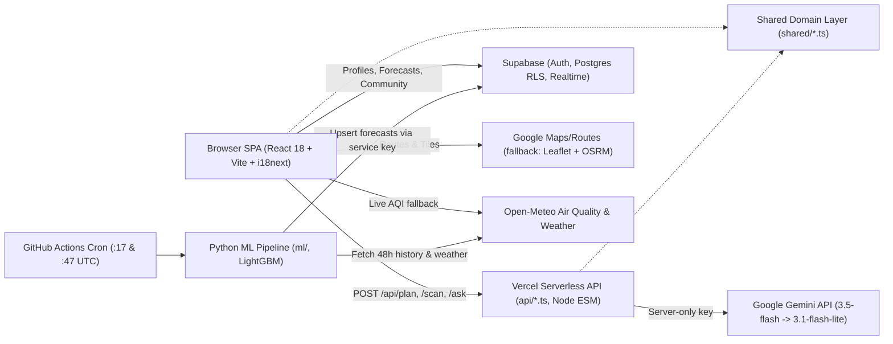

# Shwas Architecture

This document explains how Shwas is structured across its React frontend, Vercel Node ESM serverless API, shared domain layer, Supabase schema, and Python LightGBM forecasting pipeline.

---

## 1. System Overview

---

## 2. Repository Layering & Module Boundaries

| Layer | Path | Responsibility | Dependency Rules |
|---|---|---|---|
| **Shared Domain** | `shared/` | Pure TypeScript types, constants, Berkeley Earth cigarette math (`cigarettes.ts`), 48h forecast window helpers (`forecastWindow.ts`), and deterministic daily plan rules (`planRules.ts`). | Zero browser globals (`window`, `document`, `localStorage`, `import.meta.env`). Explicit `.js` relative imports for Node ESM compatibility. |
| **Serverless API** | `api/` & `api/_lib/` | Vercel Node ESM endpoints (`health.ts`, `plan.ts`, `scan.ts`, `ask.ts`) plus internal libraries (`errors.ts`, `http.ts`, `validation.ts`, `rateLimiter.ts`, `geminiTransport.ts`, `geminiClient.ts`, `logger.ts`, and per-endpoint `plan/`, `scan/`, `ask/` folders). | Imports only from `api/_lib/` and `shared/`. **Zero imports from `src/`.** Files under `_lib/` are ignored as Vercel routes. |
| **Frontend App** | `src/` | Thin lazy-loaded route pages (`src/pages/`), feature modules (`src/features/{onboarding,today,scan,routes,community,ask}/`), client services (`src/lib/`), shared layout/UI (`src/components/`), and 6 locale files (`src/locales/`). | Uses `@shared/*` alias for pure domain logic and `src/lib/storage.ts` for all `localStorage` access. Never reads server secrets. |
| **ML Pipeline** | `ml/` | Modular Python 3.11 forecasting pipeline: `config.py`, `features/` (cleaning, origin features, horizon framing, temporal split, AQI), `collect.py` + `collect_lib/`, `train.py`, `evaluate.py` + `eval_lib/`, `predict.py`, and `test_features.py`. | Checked with `ruff check`, `ruff format`, and `pytest`. Runs offline for training/eval and on GitHub Actions for hourly inference. |
| **Database** | `supabase/migrations/` | Ordered, idempotent SQL migrations (`001_profiles.sql` through `005_join_by_code.sql`) defining tables, constraints, triggers, RLS policies, and `SECURITY DEFINER` RPCs. | Applied manually via Supabase SQL Editor; RLS enabled on every public table. |

---

## 3. Serverless Request Flows

Every endpoint is wrapped with `withApiHandler` (`api/_lib/http.ts`), which enforces the HTTP method, maps typed `ApiError` subclasses (`ValidationError` -> 400, `MethodNotAllowedError` -> 405, `RateLimitError` -> 429, `UpstreamError`/`GeminiError` -> 502) to consistent JSON responses, and logs unexpected errors via `api/_lib/logger.ts`.

### `GET /api/health`
- Lightweight `{ ok: true }` warmup probe invoked once on app mount (`AppLayout.tsx`) to reduce serverless cold-start latency before the user triggers `/api/plan` or `/api/ask`.

### `POST /api/plan` (`api/_lib/plan/`)
1. **Validate** request payload (`profile`, `forecast`, `currentPm25`, `language`).
2. **Cache lookup**: Checks `InMemoryPlanCache` (6-hour TTL keyed by location bucket, PM2.5 band, language, and household signature) to avoid redundant Gemini calls.
3. **Generate**: Summarizes the 48h forecast to 8 key points (`prompt.ts`) and invokes `callGeminiJson` (`thinkingLevel: "minimal"`, `maxOutputTokens: 900`) with automatic retry + fallback from `gemini-3.5-flash` to `gemini-3.1-flash-lite`.
4. **Normalize & Cap**: Applies deterministic cigarette savings rules from `shared/planRules.ts` so displayed baseline, post-plan exposure, and savings badge always agree.
5. **Fallback**: If Gemini is unavailable or times out, returns a deterministic rule-based plan with positive savings so the Today screen is always actionable.

### `POST /api/scan` (`api/_lib/scan/`)
1. **Validate** image MIME type and payload size (strict 5 MB cap).
2. **Vision Inference**: Sends the room/kitchen/window photo to Gemini Vision (`prompt.ts`) requesting structured JSON hotspots with normalized bounding boxes (`[ymin, xmin, ymax, xmax]`), pollution source type, severity, and localized rationale.
3. **Deterministic Impact**: Client maps detected sources to evidence-backed indoor fixes and cigarette reductions (`src/lib/fixes.ts`, `src/lib/fixesCatalog.ts`) with one-tap "Add to my plan" integration.

### `POST /api/ask` (`api/_lib/ask/`)
1. **Validate** question text, conversation history, active profile/AQI context, and language (`schema.ts`).
2. **Rate Limit**: Checks `InMemoryRateLimiter` (`api/_lib/rateLimiter.ts`, 20 requests/client/24h). Note: this limiter is per serverless instance; cold starts or horizontal scaling reset instance memory, while keeping zero external store latency/cost.
3. **Grounded Answer**: Builds a compact system prompt (`prompt.ts`) anchored to the family's live PM2.5, cigarette equivalent, and health flags with medical safety guardrails (never diagnoses or prescribes; directs severe symptoms to emergency care).

---

## 4. ML Training & Serving Pipeline

1. **Collection (`ml/collect.py` + `ml/collect_lib/`)**: Fetches 2.5 years of hourly PM2.5 (OpenAQ v3 CPCB stations when `OPENAQ_API_KEY` is present, otherwise Open-Meteo Air Quality archive) and weather (`wind_speed_10m`, `wind_direction_10m`, `temperature_2m`, `relative_humidity_2m`, `precipitation`, `boundary_layer_height`) for 3 Delhi zones (Anand Vihar, R.K. Puram, ITO).
2. **Cleaning & Feature Engineering (`ml/features/`)**:
   - `cleaning.py`: Resamples to a strict 1-hour IST grid, drops `<0` or `>999` sensor errors, masks stuck flatlines (`>6h` identical values), and linearly interpolates only short gaps (`<=3h`).
   - `origin.py`: Computes PM2.5 lags (`1h, 3h, 6h, 24h`), rolling means (`6h, 12h, 24h`), diffs, cyclical hour features, wind vector `(u, v)`, and India-specific calendar flags (weekend, Diwali `+/-1` day, Oct–Nov stubble season).
   - `horizon.py`: Expands into direct multi-horizon `(origin_time, horizon=1..48)` rows using strictly causal lags plus target-hour meteorological features.
   - `split.py`: Enforces strict chronological train/val/test splits with a 48-hour embargo (zero temporal leakage), holding out the latest complete Delhi winter for testing.
3. **Training & Evaluation (`ml/train.py`, `ml/evaluate.py` + `ml/eval_lib/`)**:
   - Tunes `LGBMRegressor(objective="regression_l1")` on validation MAE only and serializes `ml/model/shwas_lgbm.joblib`.
   - Evaluates against Persistence (`next = now`) and Same-Hour-Yesterday baselines, exports diagnostic plots + SHAP importances to `ml/reports/`, and syncs summary metrics to `src/data/mlMetrics.json`.
4. **Zero-Cost Serving (`.github/workflows/forecast.yml` + `ml/predict.py`)**:
   - Runs twice hourly at off-peak UTC minutes (`:17` and `:47`) to avoid GitHub Actions `:00/:05` scheduling delays.
   - Upserts 48-hour predictions into Supabase `public.forecasts` using `SUPABASE_SERVICE_ROLE_KEY`.
   - The frontend reads ML predictions from Supabase whenever they are under 6 hours old and falls back automatically to Open-Meteo live forecasts, then to an offline curve.

---

## 5. Key Engineering & Security Decisions

- **Deterministic Science, Generative Coaching**: Cigarette equivalents (`22 ug/m3 PM2.5 for 24h = 1 cigarette`), member age/health sensitivity multipliers, indoor fix savings, and route CO2/exposure calculations are computed deterministically in `shared/` and `src/lib/`. Gemini is never relied on for arithmetic.
- **Single Source of Truth on Today**: The Today hero card, plan reduction pill (`before -> after`), and savings badge all derive from one unified base cigarette calculation (`useTodayPlan.ts` + `HeroExposureCard.tsx`).
- **Defense-in-Depth Security**:
  - `GEMINI_API_KEY` and `SUPABASE_SERVICE_ROLE_KEY` never enter the Vite bundle.
  - `vercel.json` attaches `X-Content-Type-Options`, `Referrer-Policy`, `X-Frame-Options`, `Permissions-Policy`, and `Content-Security-Policy-Report-Only`.
  - Supabase RLS protects every table (`001_profiles.sql` through `005_join_by_code.sql`); `public.groups` rows are readable only by members/creators, and joining by code uses the `SECURITY DEFINER` RPC `join_group_by_code(code, display_name)` with `EXECUTE` revoked from `anon`.
- **Resilient Browser Storage**: All `localStorage` reads/writes go through `src/lib/storage.ts`, which catches `SecurityError`, `QuotaExceededError`, and malformed JSON gracefully while logging warnings via `src/lib/logger.ts`.
- **Verified 6-Language Localization**: Every user-visible string across all 6 screens lives in `src/locales/{en,hi,te,ta,bn,mr}.json`. `src/lib/i18n.test.ts` verifies 100% key and `{{placeholder}}` parity across all 6 locales and runs a TypeScript AST check over every `.tsx` file to block untranslated English UI literals.
- **Frontend Performance**: All 6 route pages are code-split with `React.lazy` + `Suspense` (`src/App.tsx`), and Vite `manualChunks` (`vite.config.ts`) isolates React, Recharts, Leaflet, Supabase, i18next, Lucide icons, and `html-to-image` so every production chunk stays under 500 kB.
