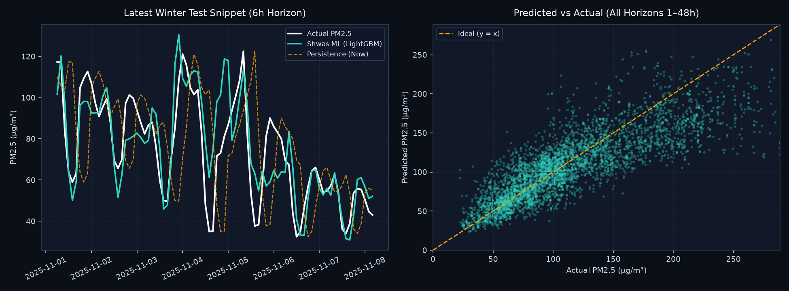
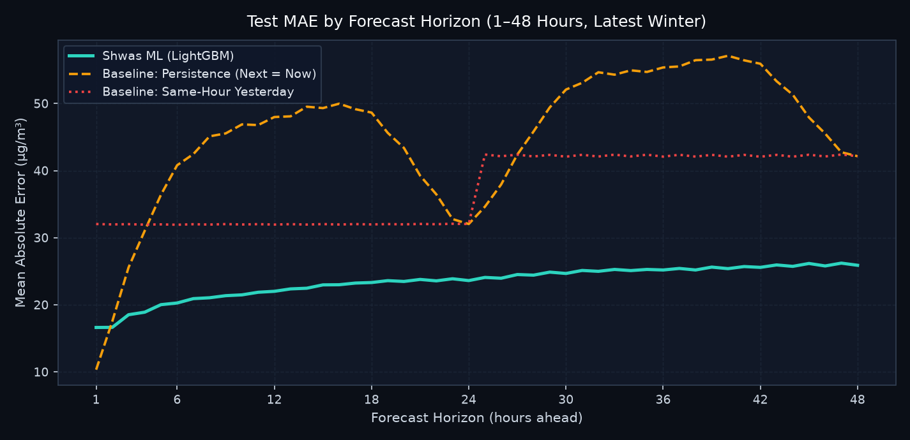
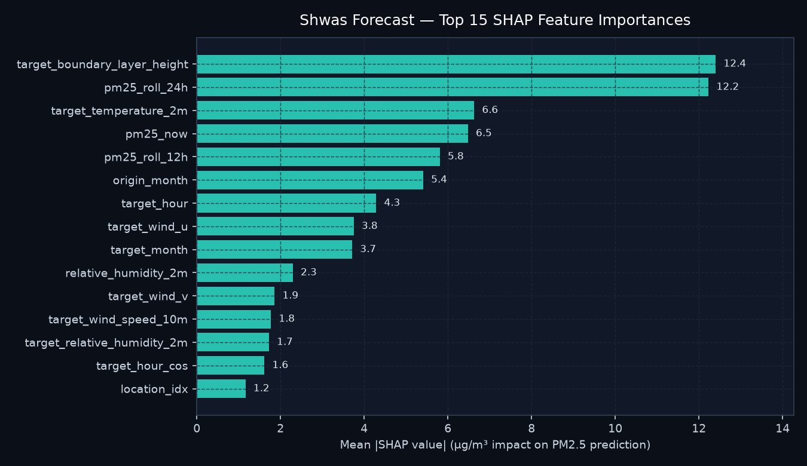

# Shwas Forecast (ML) — Evaluation Report

- **Model:** `shwas-lgbm-v1` (LightGBM Regressor with horizon 1–48h as a feature)
- **Evaluated at:** 2026-11-26 07:07 UTC
- **Held-out Test Split (Latest Winter):** `2025-11-01 00:00:00+05:30` → `2026-02-19 00:00:00+05:30` (190,224 forecast rows across 3 Delhi stations)

## Overall Test Metrics (1–48h)

| Model | MAE (µg/m³) | RMSE (µg/m³) | AQI Category Accuracy |
|---|---:|---:|---:|
| **Shwas ML (LightGBM)** | **23.44** | **33.23** | **74.1%** |
| Baseline: Persistence (next = now) | 45.23 | 62.01 | 57.3% |
| Baseline: Same-Hour Yesterday | 37.12 | 52.96 | 64.1% |

**Winner: Shwas ML (LightGBM)** — beats the strongest baseline by **+36.9%** MAE (23.44 vs 37.12 µg/m³) on the held-out latest winter test set.

## MAE by Forecast Horizon (µg/m³)

| Horizon Bucket | Shwas ML (LightGBM) | Persistence | Same-Hour Yesterday | Best |
|---|---:|---:|---:|---|
| 1–6h | 18.49 | 26.95 | 31.99 | Shwas ML (LightGBM) |
| 7–12h | 21.45 | 45.80 | 31.99 | Shwas ML (LightGBM) |
| 13–24h | 23.27 | 43.69 | 32.02 | Shwas ML (LightGBM) |
| 25–48h | 25.25 | 50.43 | 42.23 | Shwas ML (LightGBM) |

## Top Features (Mean |SHAP| µg/m³)

| Rank | Feature | Mean \|SHAP\| (µg/m³) |
|---:|---|---:|
| 1 | `target_boundary_layer_height` | 12.40 |
| 2 | `pm25_roll_24h` | 12.23 |
| 3 | `target_temperature_2m` | 6.63 |
| 4 | `pm25_now` | 6.48 |
| 5 | `pm25_roll_12h` | 5.81 |
| 6 | `origin_month` | 5.41 |
| 7 | `target_hour` | 4.29 |
| 8 | `target_wind_u` | 3.75 |
| 9 | `target_month` | 3.71 |
| 10 | `relative_humidity_2m` | 2.30 |

## Charts

